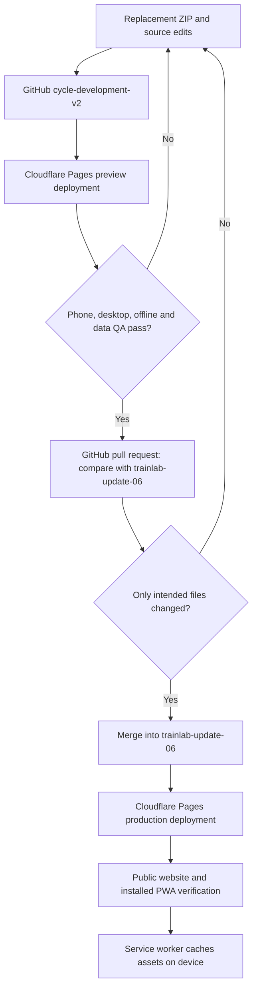
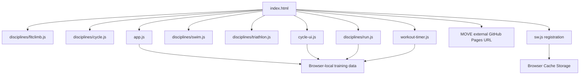

# A1SC Train Lab — Architecture & Release Reference

**Baseline:** user-supplied ZIP of production branch `trainlab-update-06`, reviewed 2026-11-05. This is a source snapshot, not a live audit of GitHub or Cloudflare settings. Maintain this document as the repository evolves.

## 1. System boundary

- **Train Lab:** static, installable PWA served by Cloudflare Pages. Main application, workout modules, images, browser-local workout data, offline service worker.
- **MOVE:** separate cycling-computer web application at `https://jjmadridt.github.io/A1SC-CycleLab-Test/`, linked from Train Lab's home screen. MOVE's source and offline implementation are **not** included in this ZIP and must be documented separately.
- **GitHub source:** `jjmadridt/A1SC-TrainLab-Test`.
- **Known branch workflow:** `cycle-development-v2` → preview; approved pull request → `trainlab-update-06` → production. Confirm settings if Cloudflare is reconfigured.
- **Known URLs:** preview `https://cycle-development-v2.a1sc-trainlab.pages.dev/`; production `https://a1sc-trainlab.pages.dev/`.

## 2. Deployment architecture



A successful Cloudflare deployment confirms publication, **not** that the UI feature or offline assets function correctly. Test the installed PWA after deployment.

## 3. Source file tree (selected; verified against ZIP)

```text
A1SC-TrainLab-Test/
├── index.html                 Shell, home cards, module navigation, scripts, update prompt
├── app.js                     Main Total Body and shared application logic
├── cycle-ui.js                Cycle UI, session handling, activity history
├── workout-timer.js           Shared timer interface/behavior
├── sw.js                      Service worker, cache name and precache list
├── manifest.webmanifest       Installed PWA identity and icon references
├── registration.html          Separate registration page (do not assume live auth)
├── admin.html                 Separate admin page (do not assume live auth)
├── disciplines/
│   ├── fitclimb.js            Total Body discipline definition
│   ├── cycle.js               Cycle discipline definition
│   ├── run.js                 Run planner, activities, display logic
│   ├── swim.js                Placeholder foundation
│   └── triathlon.js           Placeholder foundation
├── anatomy/                   Total Body male/female images, legacy SVG/PNG
│   └── run/                   Run exercise male/female PNG images
├── cycle-icons/               Cycle male/female WebP category illustrations
├── home-images/               Home discipline cards
├── icon-192.png, icon-512.png PWA launcher icons
├── brand-logo.png             Brand image
├── run.jpg, cycle.jpg, swim.jpg, tri.jpg, strength.jpg
└── README.md, REVIEW_NOTES.txt
```

**Note:** `REVIEW_NOTES.txt` identifies some Total Body illustration matches as provisional. Visual consistency does not establish exercise-specific anatomical accuracy; review before presenting them as precise instruction.

## 4. Runtime relationships (source-confirmed)



The script order above is the actual order in `index.html`. The root `index.html` also holds the English/Spanish home-card labels. Changing `disciplines/run.js` alone does **not** remove a `Beta` label in the home screen.

### Local data and offline notes

- `cycle-ui.js`, `workout-timer.js`, and `disciplines/run.js` reference the browser storage key `fitclimb-v1`. Treat this as a **shared data compatibility constraint**; do not rename it casually.
- `sw.js` contains a versioned cache name and an explicit list of assets. New images/scripts must be checked for precaching and cache-version changes.
- Offline functionality is established by practical testing but must be retested after modifying asset paths, cache rules, or initialization.
- Browser-local data is device/browser-specific; GitHub and Cloudflare do not store athlete workout history just because they host the app. Preserve backup/export workflows.

## 5. Development and release checklist

1. **Scope:** Identify exactly which files and features will change. Keep unrelated modules untouched.
2. **Package:** Deliver a ZIP with correct filenames and paths; check JavaScript syntax.
3. **Development:** Upload to `cycle-development-v2` in the correct folder. Confirm GitHub path and commit.
4. **Preview:** Confirm Cloudflare preview deployment success.
5. **Functional QA:** Exercise selection, saved weekly plan, timer, completion/partial activity, history, delete confirmation, translations, gender illustrations.
6. **Persistence QA:** Close and reopen; verify workout history and recurring plan remain intact.
7. **Offline QA:** First load assets online; airplane mode, restart, timer recovery, image visibility, activity operations.
8. **Diff review:** Compare `cycle-development-v2` against `trainlab-update-06`. Reject accidental root duplicates or unrelated changes.
9. **Merge:** Create pull request, verify checks/conflicts, merge approved change.
10. **Production:** Confirm new Cloudflare production commit and test installed phone app; honor Update Available prompt.
11. **Record:** Document new paths, storage keys, cache versions, regressions and test outcomes in this reference.

## 6. Lessons from Cycle and Run

- GitHub's **root** and `disciplines/` are different upload destinations. `run.js` belongs in `disciplines/`, not the root.
- Deleting a file and uploading its replacement in separate commits creates a temporary missing-file preview. Prefer in-place replacement where practical; verify path before committing.
- A successful deployment does not prove a Delete button was added; inspect source and test the feature.
- Home-card status is controlled by `index.html`; module functionality and card labels are separate.
- Offline icon issues require checking actual asset paths and the `sw.js` precache list.
- Verify the diff before merge: accidental deletions and restorations should cancel out; only intended changes remain.
- Preserve development branch after release for the next module.

## 7. Swim development guardrails

- Start with `disciplines/swim.js`, which is a placeholder in this production snapshot; build new functionality in development only.
- Pool and open-water workouts require different inputs and validation; do not assume GPS tracking while the phone is poolside.
- Timers should calculate elapsed time using timestamps so a locked screen does not create false time readings; test on actual devices. A PWA cannot guarantee continuous execution of JavaScript while suspended.
- Reuse the proven weekly planner, bilingual labels, activity persistence, deletion confirmation, and offline QA patterns without blindly copying discipline-specific UI.
- Use the approved realistic athlete illustration style, with exact asset names/paths recorded and cached.
- Complete Swim before Triathlon integration.

## 8. Items not verified from this ZIP

- Current Cloudflare dashboard configuration, access permissions, custom domains, build commands and environment variables.
- Full live GitHub branch state after the uploaded ZIP was downloaded.
- MOVE's source structure, GPS background behavior, service worker and data storage.
- Any future registration/approval backend; `registration.html` and `admin.html` alone are not proof of one.
- Comprehensive mapping of every function and storage field; inspect specific files when changing them.

**Release rule:** Never merge because a deployment says Success. Merge only after source diff review and behavior testing; then verify production separately.
